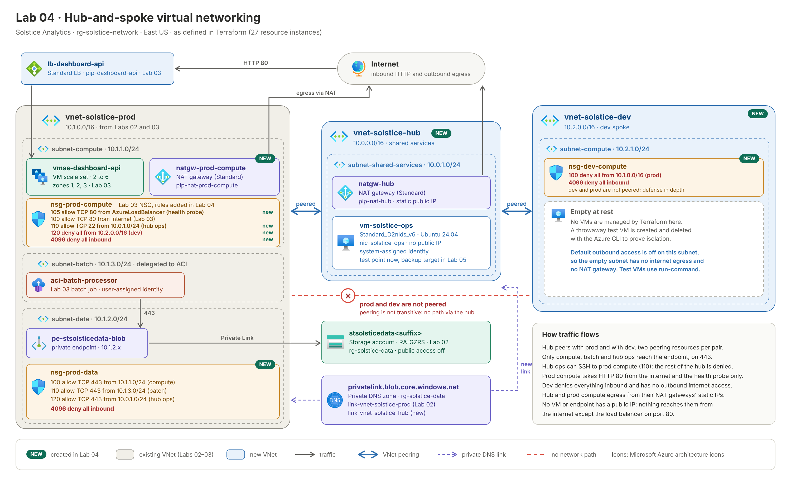

# Lab 04 — Virtual Networking
**Solstice Analytics — Azure Cloud Engineering Portfolio**
**AZ-104 Domain:** Implement and manage virtual networking (15–20%)

> **Note:** Solstice Analytics is a fictional company created for a personal portfolio lab series. The scenario is invented; the Azure work is real and was built and tested in my own subscription.

## Summary

- **I built** a hub-and-spoke network around the prod VNet from Labs 02 and 03: a new hub (`vnet-solstice-hub`), a new dev spoke (`vnet-solstice-dev`), and VNet peering between the hub and each spoke. I kept prod and dev unpeered on purpose.
- **I locked down** the existing workloads with NSGs. The data subnet accepts HTTPS only from the compute, batch and hub ops subnets. The Lab 03 compute NSG now ends in a default-deny that allows only the health probe, HTTP from the internet and SSH from the hub ops subnet. Dev has explicit denies, and its default outbound access is off.
- **I replaced** the scale set's implicit outbound (the load balancer's default SNAT) with NAT gateways, so the hub and prod compute leave from known static public IPs.
- **I added** a private ops VM in the hub with no public IP, linked the Lab 02 private DNS zone to the hub so it resolves the storage private endpoint, and enabled a system-assigned identity for Lab 05.
- **I rebuilt it all as code:** 27 resource instances in Terraform, applied on top of Labs 02 and 03 without changing any of their resources. The hardening pass added two rules and updated two others in place.

**Tools:** Microsoft Azure · Virtual Networks · VNet Peering · NSGs · NAT Gateway · Private DNS · Terraform · Azure CLI

**Jump to:** [Business Problem](#business-problem) · [Architectural Design](#architectural-design) · [Design Decisions](#design-decisions) · [Future Considerations](#future-considerations)

---

## Builds On Labs 01–03

| From | How this lab uses it |
|---|---|
| Lab 01 policies | Already assigned to `rg-solstice-network` in Lab 02, so every new resource here is covered and must carry `CostCenter` |
| Lab 02 `vnet-solstice-prod` and `subnet-data` | Peered to the hub; `subnet-data` gets `nsg-prod-data`. Lab 02 set `private_endpoint_network_policies = "Enabled"` on this subnet, which is what lets the NSG filter traffic to the private endpoint |
| Lab 02 private DNS zone | Linked to the hub so the ops VM resolves the storage account to its private IP |
| Lab 03 `subnet-compute` and `nsg-prod-compute` | Gets four new NSG rules (health probe, SSH from ops, deny from dev, deny-all) and a NAT gateway. Lab 03 defined its NSG rules as separate resources, so Lab 04 can add rules without the two configurations fighting over the NSG |
| Lab 03 `subnet-batch` | Its address range is allowed through the data-subnet NSG |

**Before you start:** Labs 01–03 applied, and the SSH public key from Lab 03 at `~/.ssh/id_rsa.pub` (or set `ssh_public_key_path`).

## Business Problem

Solstice is splitting its single flat network into proper environments after a near-miss where a dev deployment briefly pointed at the production database connection string. Engineering leadership's requirement:

> "Dev and prod need to be network-isolated from each other, but both need to reach the shared data tier from Lab 02, and nothing outside our network should be able to reach compute directly."

Today everything lives in one prod VNet. Nothing restricts which subnets can reach the storage private endpoint, and the scale set's outbound traffic leaves through whatever address the load balancer happens to use.

## Architectural Design

I put the shared services in a new **hub** VNet: the ops VM and a NAT gateway. The existing **prod** VNet and a new **dev** VNet are spokes. Each spoke peers with the hub using two peering resources, one per direction. Prod and dev don't peer with each other. Peering isn't transitive, so dev has no network path to prod through the hub.

NSGs control what can talk to what. The data subnet, which holds the Lab 02 private endpoint, accepts TCP 443 only from the compute, batch and hub ops subnets and denies everything else. The prod compute NSG accepts HTTP from the internet, the load balancer's health probe and SSH from the hub ops subnet, and denies everything else. The dev subnet denies all inbound traffic and has default outbound access turned off. NAT gateways give the hub and prod compute subnets fixed outbound IPs. I linked the private DNS zone to the hub as well as prod, so the ops VM resolves the storage account to its private address.



| Layer | Resources (27 in Terraform) | Purpose |
|---|---|---|
| Network | `vnet-solstice-hub` (10.0.0.0/16) with `subnet-shared-services` (10.0.1.0/24); `vnet-solstice-dev` (10.2.0.0/16) with `subnet-compute` (10.2.1.0/24), default outbound access off — 4 resources | Hub for shared services; dev spoke isolated from prod and without internet egress |
| Peering | `hub-to-prod`, `prod-to-hub`, `hub-to-dev`, `dev-to-hub` — 4 resources | Each spoke reaches the hub; prod and dev stay unconnected |
| Network security | `nsg-prod-data` and `nsg-dev-compute` with their subnet associations, plus four rules on the Lab 03 `nsg-prod-compute` (`allow-lb-health-probe`, `allow-ssh-from-ops`, `deny-dev-inbound`, `deny-all-inbound`); `nsg-dev-compute` carries its other deny rule inline — 8 resources | Locks down the data tier, keeps prod compute to the probe, HTTP and hub SSH, and denies traffic between environments |
| Outbound | `pip-nat-hub`, `pip-nat-prod-compute`, `natgw-hub`, `natgw-prod-compute`, and their public IP and subnet associations — 8 resources | Fixed, known egress IPs for the hub and prod compute |
| Private DNS | `link-vnet-solstice-hub` on the Lab 02 `privatelink.blob.core.windows.net` zone — 1 resource | The hub resolves the storage account to the private endpoint |
| Ops VM | `nic-solstice-ops`, `vm-solstice-ops` (`Standard_D2nlds_v6`, Ubuntu 24.04, no public IP, system-assigned identity) — 2 resources | Private test point inside the network; Lab 05's backup and monitoring target |

Resource layout:

```
rg-solstice-network
├── vnet-solstice-hub (10.0.0.0/16)                         NEW
│   └── subnet-shared-services (10.0.1.0/24)
│         ├── vm-solstice-ops + nic-solstice-ops  (no public IP)
│         └── natgw-hub + pip-nat-hub
│
├── vnet-solstice-prod (10.1.0.0/16)                        from Labs 02–03
│   ├── subnet-compute (10.1.1.0/24)   VMSS · nsg-prod-compute (+4 rules, deny-all) · NEW natgw-prod-compute + pip-nat-prod-compute
│   ├── subnet-data    (10.1.2.0/24)   private endpoint · NEW nsg-prod-data
│   └── subnet-batch   (10.1.3.0/24)   ACI batch job
│
├── vnet-solstice-dev (10.2.0.0/16)                         NEW
│   └── subnet-compute (10.2.1.0/24)   nsg-dev-compute (deny from prod, deny-all) · default outbound access off
│
└── Peerings: hub ↔ prod, hub ↔ dev        prod ✕ dev (not peered)

rg-solstice-data (Lab 02)
└── privatelink.blob.core.windows.net
      ├── link-vnet-solstice-prod   (Lab 02)
      └── link-vnet-solstice-hub    NEW
```

## Design Decisions

- **Hub-and-spoke instead of one flat VNet.** I wanted shared services in one place and the environments kept apart. Prod and dev each peer with the hub but not with each other, and peering isn't transitive, so dev has no network path to prod. A flat network would have relied on NSG rules alone to keep the environments apart, which is the kind of control that failed in the near-miss.
- **I reused the prod VNet instead of recreating it.** Labs 02 and 03 already placed storage and compute in it, and rebuilding it would have meant destroying the data tier. In Terraform, prod and its subnets are `data` sources, so this lab only adds peerings, NSGs and associations around them. Destroying Lab 04 leaves Labs 02 and 03 intact.
- **Default-deny on the prod compute NSG.** I ended the Lab 03 NSG with a `4096` deny-all. Azure's built-in `AllowVnetInBound` rule (65000) would otherwise let the hub's whole address space reach prod compute on any port. The only allows are the health probe (priority 105), HTTP from the internet (Lab 03, priority 100) and SSH from the hub ops subnet (110). The probe allow has to sit above the deny, or the load balancer can't reach the instances.
- **Default outbound access off on dev.** I set `default_outbound_access_enabled = false`, which removes the implicit outbound IP Azure gives subnets without a NAT gateway. The dev subnet has no internet egress. That's fine for now, because dev is empty at rest and I manage test VMs with run-command. The batch subnet keeps the default, because ACI needs outbound access to pull its image.
- **Explicit allows, then an explicit deny, on the data subnet.** `nsg-prod-data` allows 443 from `subnet-compute`, `subnet-batch` and the hub ops subnet, then denies everything at priority 4096. Without that deny, the default `AllowVnetInBound` rule would let any peered address reach the endpoint.
- **Deny rules in both directions between environments.** `deny-dev-inbound` on prod compute and `deny-from-prod` on dev do nothing today, because the VNets aren't peered. I kept them anyway. They cost nothing and still protect prod if someone peers the two later.
- **VNet peering instead of a VPN gateway.** Everything stays inside Azure, so peering is cheaper and has lower latency. A gateway is for on-premises or cross-region connectivity, which Solstice doesn't need yet.
- **NAT gateways for outbound, no public IPs on workloads.** Egress from the hub and prod compute leaves from known static addresses a partner could allowlist. A NAT gateway can only attach to subnets in its own VNet, so there's one for the hub and one for prod compute. On prod compute it takes over from the load balancer's default outbound SNAT without any change to the scale set.
- **No route table pointing at the NAT gateway.** A NAT gateway attaches to a subnet and takes effect automatically. A user-defined route can't use it as a next hop, so I didn't create one.
- **Ops VM in the hub, private only.** It's a place to test from inside the network without opening any inbound path from the internet. I manage it with `az vm run-command`. I used `Standard_D2nlds_v6` and Ubuntu 24.04 to match Lab 03, because the `Standard_B1s` I first planned wasn't available (see Findings).
- **`for_each` over a `nat_subnets` map.** One definition builds the public IP, the NAT gateway and both associations for the hub and for prod compute. Adding NAT to another subnet is one more line in the map.
- **Separate rule resources on an NSG another lab owns.** Lab 03 owns `nsg-prod-compute`, so I added `azurerm_network_security_rule` resources to it instead of redefining the NSG. The two NSGs this lab owns define their rules inline.
- **`depends_on` where there's no reference.** The subnet NAT association waits for the public IP association, so a NAT gateway is never attached to a subnet without an IP. The ops VM waits for the hub NAT association so it has outbound access for package updates from first boot.

## Known Limitations

- **Hub access to prod compute is limited to SSH, but not to a specific user or key.** The deny-all blocks every other port from the hub, but anyone on the ops VM with the right key can SSH in. The NSG controls the network path, not who logs in.
- **`subnet-batch` keeps Azure's default outbound access.** It has no NAT gateway, so the batch job reaches ACR and other Azure endpoints through an implicit Microsoft-owned IP that isn't known or stable. I left it that way for now. Dev has default outbound access off, so it has no internet egress at all.
- **The health probe rule depends on port 80.** If the Lab 03 probe moves to another port, the probe rule has to change with it, or the load balancer stops routing to the instances. Right now that's a manual change across two labs' code, because the probe port lives in Lab 03 and the NSG rule lives in Lab 04.
- **The hub subnet has no NSG.** It relies on having no public IPs and no inbound path from the internet. Anything the hub can reach is limited by the NSGs on the spokes instead.
- **NAT gateways here aren't zone-redundant.** Lab 03's scale set spans three zones, but a Standard NAT gateway lives in a single zone or no zone, so outbound is less resilient than inbound.
- **No firewall.** NSGs filter by address and port only. Centralized, FQDN-aware egress filtering and logging needs Azure Firewall.
- **Dev connectivity tests use a throwaway VM** created and deleted with the Azure CLI, not managed in Terraform. That keeps the dev spoke empty at rest.

## Future Considerations

- Next, I'd give `subnet-batch` a NAT gateway and set its `default_outbound_access_enabled` to `false`, so no subnet relies on implicit outbound.
- I'd like to put Azure Firewall (Basic, for cost) in the hub for centralized egress filtering and logging, with UDRs from the spokes. That's where routing through the hub and "allow forwarded traffic" start to matter.
- Zone-redundant outbound for the scale set: a NAT gateway per zone, or a zone-redundant NAT gateway SKU where available.
- Azure Bastion in the hub for interactive SSH to the ops VM without a public IP, instead of relying only on `az vm run-command`.
- A VPN or ExpressRoute gateway in the hub if Solstice needs on-premises connectivity.
- Application Gateway with WAF in front of the Lab 03 load balancer.

*Exam-prep notes mapping this lab to AZ-104 sub-skills are kept separately in [STUDY-NOTES.md](./STUDY-NOTES.md).*

---

## Step 1 — Build It in the Portal

I built the lab by hand first, so I could see every setting before writing any code.

1. **Create the hub and dev VNets** in `rg-solstice-network`: `vnet-solstice-hub` (10.0.0.0/16, subnet `subnet-shared-services` 10.0.1.0/24) and `vnet-solstice-dev` (10.2.0.0/16, subnet `subnet-compute` 10.2.1.0/24). Tag both `CostCenter = SOL-001`; the inherited policy rejects them otherwise.

2. **Peer hub ↔ prod and hub ↔ dev.** VNet → Peerings → Add, with both directions (the portal creates both at once). Leave "allow forwarded traffic" and gateway transit off; nothing routes through the hub yet.

3. **Lock down the data subnet.** Create `nsg-prod-data` with inbound allows for TCP 443 from 10.1.1.0/24 (priority 100), 10.1.3.0/24 (110) and 10.0.1.0/24 (120), then a deny-all at priority 4096. Associate it with `subnet-data`.

4. **Extend the compute NSG.** On `nsg-prod-compute` (from Lab 03) add: allow TCP 22 from 10.0.1.0/24 (priority 110) and deny all from 10.2.0.0/16 (priority 120).

5. **Create `nsg-dev-compute`** with a deny rule for all inbound traffic from 10.1.0.0/16 (priority 100) and associate it with the dev subnet.

6. **Create the NAT gateways.** `natgw-hub` on `subnet-shared-services` and `natgw-prod-compute` on prod's `subnet-compute`, each with its own Standard static public IP (`pip-nat-hub`, `pip-nat-prod-compute`).

7. **Link the private DNS zone to the hub.** Private DNS zone `privatelink.blob.core.windows.net` → Virtual network links → add `vnet-solstice-hub`. As in Lab 02, the portal can't tag the link, so I created it with the Azure CLI because the tag policy denied it:

   ```powershell
   $hubId = az network vnet show -g rg-solstice-network -n vnet-solstice-hub --query id -o tsv
   az network private-dns link vnet create -g rg-solstice-data -z privatelink.blob.core.windows.net `
     -n link-vnet-solstice-hub -v $hubId -e false --tags CostCenter=SOL-001
   ```

8. **Create the ops VM** `vm-solstice-ops` in the hub subnet: Ubuntu 24.04, `Standard_D2nlds_v6`, SSH key, **no public IP**, system-assigned identity on.

## Step 2 — Rebuild It in Terraform

Once the portal build worked, I rewrote the whole thing in Terraform.

```
Terraform/
├── providers.tf
├── variables.tf
├── data.tf
├── main.tf
├── outputs.tf
└── .terraform.lock.hcl
```

`terraform.tfvars` (not committed):

```hcl
subscription_id = "00000000-0000-0000-0000-000000000000"
```

### Implementation Notes

- **`data.tf` looks up everything this lab extends**: the network resource group, the prod VNet and its compute and data subnets, the private DNS zone, and the Lab 03 compute NSG. If Labs 02 and 03 aren't applied, `plan` fails here, which is the behavior I wanted.
- **Prod is a `data` source here, not a resource.** I didn't want this configuration managing prod. The plan showed 0 changes to existing resources, and destroying Lab 04 leaves Labs 02 and 03 intact.
- **Two peering resources per pair.** Peering is one-directional, so I created one on each side. Both reference both VNets, so Terraform creates them after the VNets and in parallel with each other.
- **Separate `azurerm_network_security_rule` resources** add to the Lab 03 NSG. I defined rules inline on the two NSGs this lab owns, since this lab owns them outright.
- **`for_each` over `nat_subnets`** builds the public IP, gateway and both associations for the hub and for prod compute. Copies are addressed by key, such as `azurerm_nat_gateway.this["hub"]`, and `[each.key]` wires each association to the matching gateway and IP.
- **The DNS link references the zone by ID** (`private_dns_zone_id`), which is how the `~> 5.0` provider takes it.
- **The ops VM `depends_on` the NAT association** so it has an outbound path from first boot. It has a system-assigned identity because Lab 05's monitoring agent authenticates with it.
- **The health probe rule uses port 80, not a port range.** It has to match the probe port in Lab 03's `azurerm_lb_probe`.

### Terraform Code

<details>
<summary><code>providers.tf</code></summary>

```hcl
# Azure Provider source and versions
terraform {
  required_version = ">= 1.5"
  required_providers {
    azurerm = {
      source  = "hashicorp/azurerm"
      version = "~> 5.0"
    }
  }
}

provider "azurerm" {
  features {}
  subscription_id = var.subscription_id
}
```

</details>

<details>
<summary><code>variables.tf</code></summary>

```hcl
variable "subscription_id" {
  type        = string
  description = "Azure subscription ID"
}

variable "ssh_public_key_path" {
  type        = string
  description = "Path to the SSH public key installed on the ops VM"
  default     = "~/.ssh/id_rsa.pub"
}
```

</details>

<details>
<summary><code>data.tf</code></summary>

```hcl
# Lab 02: network resource group, prod VNet, data subnet, private DNS zone
data "azurerm_resource_group" "network" {
  name = "rg-solstice-network"
}

data "azurerm_virtual_network" "prod" {
  name                = "vnet-solstice-prod"
  resource_group_name = data.azurerm_resource_group.network.name
}

data "azurerm_subnet" "prod_data" {
  name                 = "subnet-data"
  virtual_network_name = data.azurerm_virtual_network.prod.name
  resource_group_name  = data.azurerm_resource_group.network.name
}

data "azurerm_private_dns_zone" "blob" {
  name                = "privatelink.blob.core.windows.net"
  resource_group_name = "rg-solstice-data"
}

# Lab 03: prod compute subnet and its NSG
data "azurerm_subnet" "prod_compute" {
  name                 = "subnet-compute"
  virtual_network_name = data.azurerm_virtual_network.prod.name
  resource_group_name  = data.azurerm_resource_group.network.name
}

data "azurerm_network_security_group" "prod_compute" {
  name                = "nsg-prod-compute"
  resource_group_name = data.azurerm_resource_group.network.name
}
```

</details>

<details>
<summary><code>main.tf</code></summary>

```hcl
locals {
  location = "eastus"
  tags = {
    CostCenter = "SOL-001"
  }
}

# The CostCenter and Allowed Locations policies were already assigned to
# rg-solstice-network in Lab 02, so every resource below inherits them.

# ---------- Hub and dev spoke ----------
resource "azurerm_virtual_network" "hub" {
  name                = "vnet-solstice-hub"
  resource_group_name = data.azurerm_resource_group.network.name
  location            = local.location
  address_space       = ["10.0.0.0/16"]
  tags                = local.tags
}

resource "azurerm_subnet" "shared_services" {
  name                 = "subnet-shared-services"
  resource_group_name  = data.azurerm_resource_group.network.name
  virtual_network_name = azurerm_virtual_network.hub.name
  address_prefixes     = ["10.0.1.0/24"]
}

resource "azurerm_virtual_network" "dev" {
  name                = "vnet-solstice-dev"
  resource_group_name = data.azurerm_resource_group.network.name
  location            = local.location
  address_space       = ["10.2.0.0/16"]
  tags                = local.tags
}

resource "azurerm_subnet" "dev_compute" {
  name                 = "subnet-compute"
  resource_group_name  = data.azurerm_resource_group.network.name
  virtual_network_name = azurerm_virtual_network.dev.name
  address_prefixes     = ["10.2.1.0/24"]
  default_outbound_access_enabled = false
}

# ---------- Peering: hub <-> prod and hub <-> dev. Prod and dev are NOT peered. ----------
resource "azurerm_virtual_network_peering" "hub_to_prod" {
  name                      = "hub-to-prod"
  resource_group_name       = data.azurerm_resource_group.network.name
  virtual_network_name      = azurerm_virtual_network.hub.name
  remote_virtual_network_id = data.azurerm_virtual_network.prod.id
}

resource "azurerm_virtual_network_peering" "prod_to_hub" {
  name                      = "prod-to-hub"
  resource_group_name       = data.azurerm_resource_group.network.name
  virtual_network_name      = data.azurerm_virtual_network.prod.name
  remote_virtual_network_id = azurerm_virtual_network.hub.id
}

resource "azurerm_virtual_network_peering" "hub_to_dev" {
  name                      = "hub-to-dev"
  resource_group_name       = data.azurerm_resource_group.network.name
  virtual_network_name      = azurerm_virtual_network.hub.name
  remote_virtual_network_id = azurerm_virtual_network.dev.id
}

resource "azurerm_virtual_network_peering" "dev_to_hub" {
  name                      = "dev-to-hub"
  resource_group_name       = data.azurerm_resource_group.network.name
  virtual_network_name      = azurerm_virtual_network.dev.name
  remote_virtual_network_id = azurerm_virtual_network.hub.id
}

# ---------- NSGs ----------
# Prod compute NSG (created in Lab 03): add SSH from the hub ops subnet, block dev
resource "azurerm_network_security_rule" "allow_lb_health_probe" {
  name                        = "allow-lb-health-probe"
  priority                    = 105
  direction                   = "Inbound"
  access                      = "Allow"
  protocol                    = "Tcp"
  source_port_range           = "*"
  destination_port_range      = "80"
  source_address_prefix       = "AzureLoadBalancer"
  destination_address_prefix  = "*"
  resource_group_name         = data.azurerm_resource_group.network.name
  network_security_group_name = data.azurerm_network_security_group.prod_compute.name
}

resource "azurerm_network_security_rule" "allow_ssh_from_ops" {
  name                        = "allow-ssh-from-ops"
  priority                    = 110
  direction                   = "Inbound"
  access                      = "Allow"
  protocol                    = "Tcp"
  source_port_range           = "*"
  destination_port_range      = "22"
  source_address_prefix       = "10.0.1.0/24"
  destination_address_prefix  = "*"
  resource_group_name         = data.azurerm_resource_group.network.name
  network_security_group_name = data.azurerm_network_security_group.prod_compute.name
}

resource "azurerm_network_security_rule" "deny_dev" {
  name                        = "deny-dev-inbound"
  priority                    = 120
  direction                   = "Inbound"
  access                      = "Deny"
  protocol                    = "*"
  source_port_range           = "*"
  destination_port_range      = "*"
  source_address_prefix       = "10.2.0.0/16"
  destination_address_prefix  = "*"
  resource_group_name         = data.azurerm_resource_group.network.name
  network_security_group_name = data.azurerm_network_security_group.prod_compute.name
}

resource "azurerm_network_security_rule" "deny_all_inbound" {
  name                        = "deny-all-inbound"
  priority                    = 4096
  direction                   = "Inbound"
  access                      = "Deny"
  protocol                    = "*"
  source_port_range           = "*"
  destination_port_range      = "*"
  source_address_prefix       = "*"
  destination_address_prefix  = "*"
  resource_group_name         = data.azurerm_resource_group.network.name
  network_security_group_name = data.azurerm_network_security_group.prod_compute.name
}

# Data subnet (private endpoint): only the tiers that need storage may connect
resource "azurerm_network_security_group" "prod_data" {
  name                = "nsg-prod-data"
  resource_group_name = data.azurerm_resource_group.network.name
  location            = local.location
  tags                = local.tags

  security_rule {
    name                       = "allow-https-from-compute"
    priority                   = 100
    direction                  = "Inbound"
    access                     = "Allow"
    protocol                   = "Tcp"
    source_port_range          = "*"
    destination_port_range     = "443"
    source_address_prefix      = "10.1.1.0/24"
    destination_address_prefix = "*"
  }

  security_rule {
    name                       = "allow-https-from-batch"
    priority                   = 110
    direction                  = "Inbound"
    access                     = "Allow"
    protocol                   = "Tcp"
    source_port_range          = "*"
    destination_port_range     = "443"
    source_address_prefix      = "10.1.3.0/24"
    destination_address_prefix = "*"
  }

  security_rule {
    name                       = "allow-https-from-hub-ops"
    priority                   = 120
    direction                  = "Inbound"
    access                     = "Allow"
    protocol                   = "Tcp"
    source_port_range          = "*"
    destination_port_range     = "443"
    source_address_prefix      = "10.0.1.0/24"
    destination_address_prefix = "*"
  }

  security_rule {
    name                       = "deny-all-inbound"
    priority                   = 4096
    direction                  = "Inbound"
    access                     = "Deny"
    protocol                   = "*"
    source_port_range          = "*"
    destination_port_range     = "*"
    source_address_prefix      = "*"
    destination_address_prefix = "*"
  }
}

resource "azurerm_subnet_network_security_group_association" "prod_data" {
  subnet_id                 = data.azurerm_subnet.prod_data.id
  network_security_group_id = azurerm_network_security_group.prod_data.id
}

# Dev compute: explicit deny from prod address space (defense in depth; dev and prod are not peered)
resource "azurerm_network_security_group" "dev_compute" {
  name                = "nsg-dev-compute"
  resource_group_name = data.azurerm_resource_group.network.name
  location            = local.location
  tags                = local.tags

  security_rule {
    name                       = "deny-from-prod"
    priority                   = 100
    direction                  = "Inbound"
    access                     = "Deny"
    protocol                   = "*"
    source_port_range          = "*"
    destination_port_range     = "*"
    source_address_prefix      = "10.1.0.0/16"
    destination_address_prefix = "*"
  }
  security_rule {
    name                       = "deny-all-inbound"
    priority                   = 4096
    direction                  = "Inbound"
    access                     = "Deny"
    protocol                   = "*"
    source_port_range          = "*"
    destination_port_range     = "*"
    source_address_prefix      = "*"
    destination_address_prefix = "*"
  }
}

resource "azurerm_subnet_network_security_group_association" "dev_compute" {
  subnet_id                 = azurerm_subnet.dev_compute.id
  network_security_group_id = azurerm_network_security_group.dev_compute.id
}

# ---------- NAT gateways: controlled outbound for hub and prod compute ----------
# A NAT gateway can only attach to subnets in its own VNet, so there is one per VNet.
locals {
  nat_subnets = {
    hub          = azurerm_subnet.shared_services.id
    prod-compute = data.azurerm_subnet.prod_compute.id
  }
}

resource "azurerm_public_ip" "nat" {
  for_each            = local.nat_subnets
  name                = "pip-nat-${each.key}"
  resource_group_name = data.azurerm_resource_group.network.name
  location            = local.location
  allocation_method   = "Static"
  sku                 = "Standard"
  tags                = local.tags
}

resource "azurerm_nat_gateway" "this" {
  for_each            = local.nat_subnets
  name                = "natgw-${each.key}"
  resource_group_name = data.azurerm_resource_group.network.name
  location            = local.location
  sku_name            = "Standard"
  tags                = local.tags
}

resource "azurerm_nat_gateway_public_ip_association" "this" {
  for_each             = local.nat_subnets
  nat_gateway_id       = azurerm_nat_gateway.this[each.key].id
  public_ip_address_id = azurerm_public_ip.nat[each.key].id
}

resource "azurerm_subnet_nat_gateway_association" "this" {
  for_each       = local.nat_subnets
  subnet_id      = each.value
  nat_gateway_id = azurerm_nat_gateway.this[each.key].id

  depends_on = [azurerm_nat_gateway_public_ip_association.this]
}

# ---------- Private DNS: let the hub resolve the Lab 02 private endpoint ----------
resource "azurerm_private_dns_zone_virtual_network_link" "hub" {
  name                 = "link-vnet-solstice-hub"
  private_dns_zone_id  = data.azurerm_private_dns_zone.blob.id
  virtual_network_id   = azurerm_virtual_network.hub.id
  registration_enabled = false
  tags                 = local.tags
}

# ---------- Ops VM in the hub (no public IP): test point now, backup target in Lab 05 ----------
resource "azurerm_network_interface" "ops" {
  name                = "nic-solstice-ops"
  resource_group_name = data.azurerm_resource_group.network.name
  location            = local.location
  tags                = local.tags

  ip_configuration {
    name                          = "internal"
    subnet_id                     = azurerm_subnet.shared_services.id
    private_ip_address_allocation = "Dynamic"
  }
}

resource "azurerm_linux_virtual_machine" "ops" {
  name                  = "vm-solstice-ops"
  resource_group_name   = data.azurerm_resource_group.network.name
  location              = local.location
  size                  = "Standard_D2nlds_v6"
  admin_username        = "solsticeadmin"
  network_interface_ids = [azurerm_network_interface.ops.id]
  tags                  = local.tags

  admin_ssh_key {
    username   = "solsticeadmin"
    public_key = file(pathexpand(var.ssh_public_key_path))
  }

  # Lab 05 installs the Azure Monitor Agent, which authenticates with this identity
  identity {
    type = "SystemAssigned"
  }

  source_image_reference {
    publisher = "Canonical"
    offer     = "ubuntu-24_04-lts"
    sku       = "server"
    version   = "latest"
  }

  os_disk {
    storage_account_type = "Standard_LRS"
    caching              = "ReadWrite"
  }

  # Outbound (apt, extensions) goes through the hub NAT gateway
  depends_on = [azurerm_subnet_nat_gateway_association.this]
}
```

</details>

<details>
<summary><code>outputs.tf</code></summary>

```hcl
output "nat_public_ips" {
  value = { for k, v in azurerm_public_ip.nat : k => v.ip_address }
}

output "ops_vm_name" {
  value = azurerm_linux_virtual_machine.ops.name
}
```

</details>

### Findings From the Terraform Build

1. **`Standard_B1s` wasn't available for the ops VM.** I hit the same capacity problem Lab 03 had with `Standard_B2s`. I switched the VM to `Standard_D2nlds_v6` and moved the image from Ubuntu 22.04 to the 24.04 image Lab 03 used (`ubuntu-24_04-lts` / `server`). Check what your subscription can deploy before you pick a size: `az vm list-skus --location eastus --resource-type virtualMachines --query "[?restrictions==\`[]\`].name" -o tsv`.
2. **The plan confirmed the lab was additive.** Before I applied on top of Labs 02 and 03, the plan showed `27 to add, 0 to change, 0 to destroy`, which matched the apply. Any change or destroy against the prod VNet, its subnets, the scale set or the NSG would have meant this configuration was managing something another lab owns, so I'd have stopped there.
3. **I caught three problems in review before applying the hardening.**
   (a) My first probe rule used the destination range `65500-65535`. That's Azure's internal range, not the probe port, so the rule now allows port 80.
   (b) My probe rule started at priority 100, the same as Lab 03's HTTP rule on the same NSG, and Azure rejects duplicate priorities. I moved it to 90 next, but that was invalid too: custom NSG rules must use priorities 100 to 4096, and the apply failed on it. It's now 105. That's unique on the NSG, sits above the 4096 deny-all, and stays below SSH at 110.
   (c) A deny-all with no allow for the probe would have stopped the load balancer from routing, because Azure's built-in probe allow (65001) sits below the 4096 deny. I added an explicit allow for the probe port.

### Terraform Workflow

```powershell
terraform init
terraform plan      # first build: 27 to add, 0 to change, 0 to destroy; hardening pass: 2 to add, 2 to change, 0 to destroy
terraform apply
terraform state list
terraform output nat_public_ips
```

## Verify

I ran almost everything through `az vm run-command`, because nothing here has a public IP.

1. **Private DNS from the hub.** The ops VM should resolve the storage account to a private address:

   ```powershell
   az vm run-command invoke -g rg-solstice-network -n vm-solstice-ops --command-id RunShellScript `
     --scripts "nslookup stsolsticedata<suffix>.blob.core.windows.net"
   ```

   Expect `10.1.2.x`. This is the check I couldn't do from my laptop in Lab 02.

2. **Egress through NAT.** From the ops VM, and from a scale set instance, `curl -s ifconfig.me` should return the matching NAT gateway's IP from `terraform output nat_public_ips`. Before this lab, the scale set's answer was the load balancer's address, so the change is easy to see.

   ```powershell
   az vm run-command invoke -g rg-solstice-network -n vm-solstice-ops --command-id RunShellScript `
     --scripts "curl -s ifconfig.me"
   az vmss run-command invoke -g rg-solstice-compute -n vmss-dashboard-api --instance-id 0 `
     --command-id RunShellScript --scripts "curl -s ifconfig.me"
   ```

3. **The Lab 03 batch job still works.** Start it again and read the logs. It reaches the private endpoint through the new data-subnet NSG, which confirms the `subnet-batch` allow rule.

   ```powershell
   az container start -g rg-solstice-compute -n aci-batch-processor
   az container logs -g rg-solstice-compute -n aci-batch-processor
   ```

4. **Dev cannot reach prod.** Create a throwaway VM in the dev subnet (no public IP), test, and delete it:

   ```powershell
   az vm create -g rg-solstice-network -n vm-dev-test --image Ubuntu2404 --size Standard_D2nlds_v6 `
     --vnet-name vnet-solstice-dev --subnet subnet-compute --public-ip-address '""' --nsg '""' `
     --admin-username solsticeadmin --generate-ssh-keys --tags CostCenter=SOL-001
   az vm run-command invoke -g rg-solstice-network -n vm-dev-test --command-id RunShellScript `
     --scripts "nc -vz -w 5 <prod-pe-private-ip> 443; nc -vz -w 5 <vmss-instance-ip> 80"
   az vm delete -g rg-solstice-network -n vm-dev-test --yes
   ```

   Both connections should time out, because there is no route from 10.2.0.0/16 to 10.1.0.0/16. The dev subnet has no outbound internet access, so don't rely on `apt` inside the test VM. Delete the VM's disk and NIC too if the CLI leaves them behind.

5. **The hub can reach prod compute on SSH only; everything else is refused.** I test from the ops VM, using bash's built-in TCP connection so nothing needs installing. Get the scale set instance's private IP first. I write the test to a file, because PowerShell and cmd.exe mangled the quoting when I passed it inline:

   ```powershell
   $vmssIp = az vmss nic list -g rg-solstice-compute --vmss-name vmss-dashboard-api `
     --query "[0].ipConfigurations[0].privateIPAddress" -o tsv

   # Write the test to a file so the bash quoting survives PowerShell and cmd.exe
   $script = "timeout 3 bash -c 'exec 3<>/dev/tcp/$vmssIp/22; head -c 20 <&3'`necho`ntimeout 3 bash -c 'exec 3<>/dev/tcp/$vmssIp/443' && echo 'HTTPS open' || echo 'HTTPS blocked'`n"
   [IO.File]::WriteAllText("$env:TEMP\verify-hub.sh", $script)

   az vm run-command invoke -g rg-solstice-network -n vm-solstice-ops --command-id RunShellScript `
     --scripts "@$env:TEMP\verify-hub.sh"
   Remove-Item "$env:TEMP\verify-hub.sh"
   ```

   Expect `SSH-2.0-OpenSSH...` on the first line (port 22 answers with the SSH banner) and `HTTPS blocked` on the second (the deny-all refuses 443). From the internet there is no path to an instance, because no instance has a public IP.

6. **The load balancer still routes to both instances.** Check the probe from the command line:

   ```powershell
   $LB_ID = az network lb show -g rg-solstice-compute -n lb-dashboard-api --query id -o tsv
   az monitor metrics list --resource $LB_ID --metric DipAvailability --interval PT1M --aggregation Average -o table
   ```

   Expect values at 100 once the instances finish cloud-init. Metrics lag a few minutes after a fresh apply. Then `curl http://<pip-dashboard-api address>/` should return responses from both instance hostnames over several requests.

## Hands Off To Lab 05

Lab 05 is where I monitor and protect what this lab leaves behind:

- the **ops VM** is the VM Azure Backup protects, and the Azure Monitor Agent installs on it using the identity enabled here,
- the **storage account and scale set** from Labs 02 and 03 are the sources for diagnostics and alerts,
- the **NAT gateways, NSGs and peerings** are the infrastructure whose changes the platform alerts on.

Leave this lab applied for Lab 05.

## Teardown

I destroy Lab 04 after Lab 05 and before Lab 03.

```powershell
terraform destroy
```

Terraform removes the peerings, NSG associations and NAT associations before the VNets, following the dependency order. The prod VNet, its subnets and `nsg-prod-compute` are untouched, because they belong to Labs 02 and 03. Only the four rules this lab added to that NSG are removed. If a destroy fails because a peering or NAT association still exists, I re-run it. I also delete the dev test VM first if I left it running.

## Cost

The two NAT gateways (an hourly charge each, plus their Standard public IPs) and the `Standard_D2nlds_v6` ops VM are the main costs, a few dollars a day together while applied. Peering is billed per GB transferred, which is negligible here. I destroy the lab at the end of each session.
