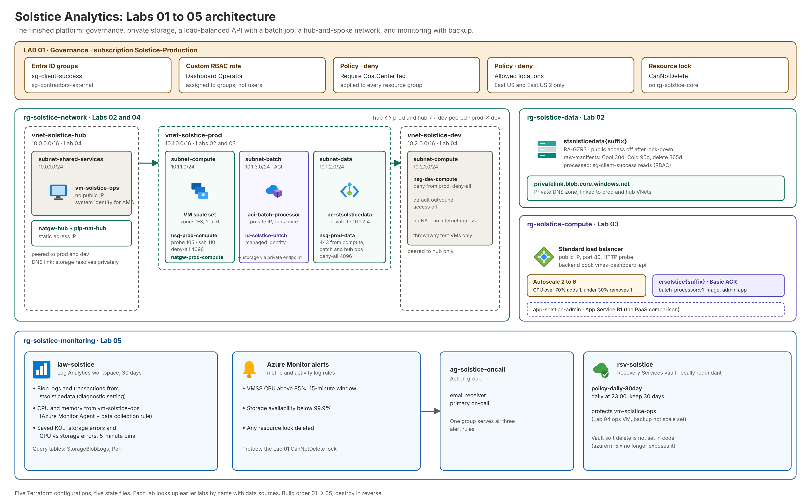

# Lab 05 — Monitor and Maintain Azure Resources
**Solstice Analytics — Azure Cloud Engineering Portfolio**
**AZ-104 Domain:** Monitor and maintain Azure resources (10–15%)

> **Note:** Solstice Analytics is a fictional company created for a personal portfolio lab series. The scenario is invented; the Azure work is real and was built and tested in my own subscription.

## Summary

- **Built** a central Log Analytics workspace that receives blob logs from the Lab 02 storage account and guest performance data from the Lab 04 ops VM, with saved KQL queries that line the two up on one timeline.
- **Set up alerts** before the client notices: metric alerts on the Lab 03 scale set's CPU and the storage account's availability, plus an activity-log alert if the Lab 01 resource lock is ever deleted, all notifying one action group.
- **Protected** the ops VM with a Recovery Services vault and a daily, 30-day backup policy, and documented why the scale set itself isn't the backup target.
- **Closed the series:** this lab monitored and recovered everything Labs 01–04 built. See *The Platform End to End* below.
- **Rebuilt the whole lab as Infrastructure as Code,** including the vault teardown behaviour.

**Tools:** Microsoft Azure · Azure Monitor · Log Analytics · KQL · Azure Monitor Agent · Alerts and Action Groups · Azure Backup · Terraform · Azure CLI

**Jump to:** [Business Problem](#business-problem) · [Architectural Design](#architectural-design) · [Design Decisions](#design-decisions) · [Future Considerations](#future-considerations)

---

## Builds On Labs 01–04

| From | How this lab uses it |
|---|---|
| Lab 01 policies | Assigned to `rg-solstice-monitoring`; resources carry `CostCenter = SOL-001` |
| Lab 01 resource lock | An activity-log alert fires if a lock is deleted |
| Lab 02 storage account | Diagnostic setting sends blob read/write/delete logs and transaction metrics to the workspace; availability alert |
| Lab 03 `vmss-dashboard-api` | CPU metric alert (platform metrics, no agent needed) |
| Lab 04 `vm-solstice-ops` | Azure Monitor Agent installed with its system-assigned identity; the VM Azure Backup protects |

**Before you start:** Labs 01–04 applied, and the Lab 03 batch job has run at least once so there is storage activity to log.

## Business Problem

Solstice just signed its first enterprise client, who asked for an uptime SLA on the dashboard API before signing. Leadership's response was "we don't actually know our uptime. We find out something's wrong when a client emails us." The ask for this lab:

> "We need to know about problems before the client does, and if something is deleted or corrupted, we need to be able to prove we can get it back."

## Architectural Design

```
rg-solstice-monitoring (new)
├── Log Analytics workspace: law-solstice
│     ├── ← diagnostic setting: Lab 02 blob service (StorageRead/Write/Delete + Transaction)
│     └── ← Azure Monitor Agent + data collection rule: Lab 04 ops VM (CPU, memory)
│     └── Saved queries: storage errors; ops-VM CPU vs. storage errors
├── Action group: ag-solstice-oncall (email)
│     ├── Metric alert: Lab 03 scale set CPU > 85% for 15 min
│     ├── Metric alert: Lab 02 storage availability < 99.9%
│     └── Activity-log alert: any resource lock deleted (protects the Lab 01 lock)
└── Recovery Services vault: rsv-solstice
      └── Backup policy: daily 23:00, 30-day retention → protects vm-solstice-ops (Lab 04)
```

## Design Decisions

- **One Log Analytics workspace.** A single place to query lets one KQL statement line up VM CPU with storage errors. That matters when a storage throttling event *looks like* a compute problem from the outside.
- **Platform metrics for the scale set, agent data for the VM.** Scale-set CPU is a free platform metric, so the alert doesn't need an agent. Guest-level data (the `Perf` table) comes from the Azure Monitor Agent on the ops VM.
- **Push alerts through an action group.** The point is "know before the client does", which needs notification rather than a dashboard someone has to remember to open.
- **An alert on lock deletion.** Lab 01's lock protects the core resource group, but a lock can be removed by anyone with the right role. The activity-log alert turns that into an event someone sees.
- **Back up the ops VM, not the scale set.** Azure Backup protects individual VMs, not scale-set instances created from a uniform model. Scale-set instances are replaceable by design (the model rebuilds them), and the storage tier already has GZRS and lifecycle policies. The VM is the stateful thing that needs a restore path.
- **30-day retention** as a starting point: long enough to catch slow-burning corruption, short enough for a lab budget. It is a business decision to revisit with real data.
- **Locally redundant vault, in the lab only.** It keeps cost down for a lab. Production would use geo-redundant storage with soft delete left on.
<!-- TODO: confirm after a clean destroy test whether soft delete was on by default and whether a manual purge was needed. -->

## Known Limitations

- **Scale-set VM logs aren't in the workspace.** Only the ops VM has the agent. Scale-set CPU is covered by the platform metric alert, but a guest-level `Perf` query doesn't see those instances. Extending the agent to the scale set (via the scale set model and an upgrade) is a natural next step.
- **The storage availability alert needs traffic.** With no requests there is no data point, so it only fires on real failures, and testing it on purpose is awkward. The CPU alert is the one tested end to end.
- **Email only.** Alerts go to one address. I left out SMS and a rota because they need real phone numbers.
- **I haven't restored the VM yet.** Verification confirms a successful backup job and a recovery point. A full restore test and measured recovery time are listed as future work.
- **Log Analytics ingestion is billed.** The lab ingests very little, but leaving it running with diagnostics on will accumulate cost.

## Future Considerations

- Perform a real restore of the ops VM into a new VM and record the recovery time as evidence.
- Azure Workbook or Grafana dashboard over the workspace for a client-facing status view.
- Application Insights once the dashboard API has real application code.
- Azure Monitor Agent on the scale set, and a VMSS-aware alert on instance count hitting the autoscale maximum.

*Exam-prep notes mapping this lab to AZ-104 sub-skills are kept separately in [STUDY-NOTES.md](./STUDY-NOTES.md).*

---

## Step 1 — Build It in the Portal

1. **Create `rg-solstice-monitoring`** (East US, tagged) and assign the Lab 01 policies.

2. **Create the workspace** `law-solstice` (Pay-as-you-go, 30-day retention).

3. **Send storage logs to it.** Storage account → Monitoring → Diagnostic settings → select the **blob** service → send `StorageRead`, `StorageWrite`, `StorageDelete` and the Transaction metric to `law-solstice`.

   <!-- Screenshot: diagnostic setting -->

4. **Collect VM performance data.** Create a data collection rule (Linux, Performance counters: processor and memory, 60-second sampling, destination `law-solstice`), associate it with `vm-solstice-ops`, and install the Azure Monitor Agent (the DCR association does this in the portal).

5. **Write and save two KQL queries** in the workspace: storage errors over 24 hours, and ops-VM CPU joined with storage errors in 5-minute bins.

   <!-- Screenshot: query results -->

6. **Create the action group** `ag-solstice-oncall` with an email receiver.

7. **Create the alert rules.**
   - Scale set `vmss-dashboard-api`: Percentage CPU, average > 85 over 15 minutes.
   - Storage account: Availability, average < 99.9 over 5 minutes.
   - Activity log alert: operation `Microsoft.Authorization/locks/delete` at subscription scope.
   All three use `ag-solstice-oncall`.

   <!-- Screenshot: alert rules list -->

8. **Create the Recovery Services vault** `rsv-solstice` (locally redundant for the lab). Create a backup policy: daily at 23:00, 30-day retention.

9. **Enable backup on `vm-solstice-ops`** and run an on-demand backup.

   <!-- Screenshot: backup job completed + recovery point -->

## Step 2 — Rebuild It in Terraform

```
Terraform/
├── providers.tf
├── variables.tf
├── data.tf
├── main.tf
├── outputs.tf
└── .terraform.lock.hcl
```

`terraform.tfvars` (not committed):

```hcl
subscription_id = "00000000-0000-0000-0000-000000000000"
name_suffix     = "rf01"                  # same as Labs 02 and 03
alert_email     = "you@example.com"
```

### Implementation Notes

- **`data.tf` is the whole chain in one file.** It looks up the Lab 01 policies, the Lab 02 storage account, the Lab 03 scale set and the Lab 04 ops VM. If any earlier lab isn't applied, `plan` fails at the lookup that is missing.
- **The storage diagnostic setting targets `.../blobServices/default`**, not the account. Blob logs are emitted by the blob service; a setting on the account only carries account-level metrics.
- **The extension, DCR and association chain:** the agent must exist before the association is useful, so the association `depends_on` the extension.
- **Counter specifiers use double backslashes** in HCL (`Processor(*)\\% Processor Time`), because the backslash is an escape character.
- **The two saved queries** use `StorageBlobLogs` (from the diagnostic setting) and `Perf` (from the agent), which is why both data paths are part of the lab.
- **The activity-log alert is scoped to the subscription** because lock deletions are recorded against the scope the lock sat on.
- **Provider `features { recovery_service { ... } }`** lets `terraform destroy` purge backup items when removing the vault. `vm_backup_stop_protection_and_retain_data_on_destroy = false` deletes VM backup data during teardown. The vault resource doesn't set soft delete, because the azurerm 5.x resource doesn't expose it.
- **Alert email is a variable**, so no address is committed to the repo.

### Terraform Code

<details>
<summary><code>providers.tf</code></summary>

```hcl
# Azure Provider source and versions
terraform {
  required_version = ">= 1.5"
  required_providers {
    azurerm = {
      source  = "hashicorp/azurerm"
      version = "~> 5.0"
    }
  }
}

provider "azurerm" {
  features {
    # Lets terraform destroy remove a vault that still holds backup items
    recovery_service {
      purge_protected_items_from_vault_on_destroy = true
      vm_backup_stop_protection_and_retain_data_on_destroy = false # lab teardown: don't keep VM backup data
    }
  }
  subscription_id = var.subscription_id
}
```

</details>

<details>
<summary><code>variables.tf</code></summary>

```hcl
variable "subscription_id" {
  type        = string
  description = "Azure subscription ID"
}

variable "name_suffix" {
  type        = string
  description = "Same suffix used in Labs 02 and 03"
}

variable "alert_email" {
  type        = string
  description = "Address that receives alert notifications"
}
```

</details>

<details>
<summary><code>data.tf</code></summary>

```hcl
data "azurerm_subscription" "current" {}

# Lab 01
data "azurerm_policy_definition" "require_costcenter" {
  name = "require-costcenter-tag"
}

data "azurerm_policy_definition" "allowed_locations" {
  name = "e56962a6-4747-49cd-b67b-bf8b01975c4c"
}

# Lab 02
data "azurerm_storage_account" "solstice" {
  name                = "stsolsticedata${var.name_suffix}"
  resource_group_name = "rg-solstice-data"
}

# Lab 03
data "azurerm_virtual_machine_scale_set" "dashboard_api" {
  name                = "vmss-dashboard-api"
  resource_group_name = "rg-solstice-compute"
}

# Lab 04
data "azurerm_virtual_machine" "ops" {
  name                = "vm-solstice-ops"
  resource_group_name = "rg-solstice-network"
}
```

</details>

<details>
<summary><code>main.tf</code></summary>

```hcl
locals {
  location = "eastus"
  tags = {
    CostCenter = "SOL-001"
  }
}

# ---------- Resource group + Lab 01 governance ----------
resource "azurerm_resource_group" "monitoring" {
  name     = "rg-solstice-monitoring"
  location = local.location
  tags     = local.tags
}

resource "azurerm_resource_group_policy_assignment" "require_costcenter" {
  name                 = "require-costcenter"
  display_name         = "Require CostCenter Tag"
  resource_group_id    = azurerm_resource_group.monitoring.id
  policy_definition_id = data.azurerm_policy_definition.require_costcenter.id
}

resource "azurerm_resource_group_policy_assignment" "allowed_locations" {
  name                 = "allowed-locations"
  display_name         = "Allowed Locations: East US, East US 2"
  resource_group_id    = azurerm_resource_group.monitoring.id
  policy_definition_id = data.azurerm_policy_definition.allowed_locations.id
  parameters = jsonencode({
    "listOfAllowedLocations" = {
      "value" = ["eastus", "eastus2"]
    }
  })
}

# ---------- Log Analytics ----------
resource "azurerm_log_analytics_workspace" "solstice" {
  name                = "law-solstice"
  resource_group_name = azurerm_resource_group.monitoring.name
  location            = local.location
  sku                 = "PerGB2018"
  retention_in_days   = 30
  tags                = local.tags
}

# Lab 02 storage: blob read/write/delete logs plus transaction metrics
resource "azurerm_monitor_diagnostic_setting" "storage_blob" {
  name                       = "diag-storage-blob-to-law"
  target_resource_id         = "${data.azurerm_storage_account.solstice.id}/blobServices/default"
  log_analytics_workspace_id = azurerm_log_analytics_workspace.solstice.id

  enabled_log {
    category = "StorageRead"
  }
  enabled_log {
    category = "StorageWrite"
  }
  enabled_log {
    category = "StorageDelete"
  }
  enabled_metric {
    category = "Transaction"
  }
}

# Lab 04 ops VM: guest CPU and memory through the Azure Monitor Agent
resource "azurerm_virtual_machine_extension" "ama" {
  name                       = "AzureMonitorLinuxAgent"
  virtual_machine_id         = data.azurerm_virtual_machine.ops.id
  publisher                  = "Microsoft.Azure.Monitor"
  type                       = "AzureMonitorLinuxAgent"
  type_handler_version       = "1.0"
  auto_upgrade_minor_version = true
  automatic_upgrade_enabled  = true
  tags                       = local.tags
}

resource "azurerm_monitor_data_collection_rule" "ops_perf" {
  name                = "dcr-solstice-ops-perf"
  resource_group_name = azurerm_resource_group.monitoring.name
  location            = local.location
  kind                = "Linux"
  tags                = local.tags

  destinations {
    log_analytics {
      workspace_resource_id = azurerm_log_analytics_workspace.solstice.id
      name                  = "law"
    }
  }

  data_sources {
    performance_counter {
      name                          = "perf"
      streams                       = ["Microsoft-Perf"]
      sampling_frequency_in_seconds = 60
      counter_specifiers = [
        "Processor(*)\\% Processor Time",
        "Memory(*)\\% Used Memory",
      ]
    }
  }

  data_flow {
    streams      = ["Microsoft-Perf"]
    destinations = ["law"]
  }
}

resource "azurerm_monitor_data_collection_rule_association" "ops" {
  name                    = "dcra-ops-perf"
  target_resource_id      = data.azurerm_virtual_machine.ops.id
  data_collection_rule_id = azurerm_monitor_data_collection_rule.ops_perf.id

  depends_on = [azurerm_virtual_machine_extension.ama]
}

# ---------- Saved KQL queries ----------
resource "azurerm_log_analytics_saved_search" "storage_errors" {
  name                       = "storage-errors-24h"
  log_analytics_workspace_id = azurerm_log_analytics_workspace.solstice.id
  category                   = "Solstice"
  display_name               = "Storage errors and throttling (24h)"
  query                      = <<-KQL
    StorageBlobLogs
    | where TimeGenerated > ago(24h)
    | where StatusCode == 429 or StatusCode >= 500 or StatusText in ("ServerBusy", "ClientThrottlingError", "AuthorizationFailure")
    | summarize Requests = count() by bin(TimeGenerated, 15m), StatusText
    | order by TimeGenerated desc
  KQL
}

resource "azurerm_log_analytics_saved_search" "cpu_vs_storage" {
  name                       = "ops-cpu-vs-storage-errors"
  log_analytics_workspace_id = azurerm_log_analytics_workspace.solstice.id
  category                   = "Solstice"
  display_name               = "Ops VM CPU vs storage errors (24h, 5 min bins)"
  query                      = <<-KQL
    let cpu = Perf
      | where TimeGenerated > ago(24h)
      | where ObjectName == "Processor" and CounterName == "% Processor Time" and InstanceName == "_Total"
      | summarize AvgCpu = avg(CounterValue) by bin(TimeGenerated, 5m);
    let storageErrors = StorageBlobLogs
      | where TimeGenerated > ago(24h)
      | where StatusCode >= 400
      | summarize StorageErrors = count() by bin(TimeGenerated, 5m);
    cpu
    | join kind=fullouter storageErrors on TimeGenerated
    | project TimeGenerated = coalesce(TimeGenerated, TimeGenerated1), AvgCpu, StorageErrors
    | order by TimeGenerated desc
  KQL
}

# ---------- Alerting ----------
resource "azurerm_monitor_action_group" "oncall" {
  name                = "ag-solstice-oncall"
  resource_group_name = azurerm_resource_group.monitoring.name
  short_name          = "solsticeoc"
  tags                = local.tags

  email_receiver {
    name          = "primary-oncall"
    email_address = var.alert_email
  }
}

resource "azurerm_monitor_metric_alert" "vmss_cpu_high" {
  name                = "alert-vmss-cpu-high"
  resource_group_name = azurerm_resource_group.monitoring.name
  scopes              = [data.azurerm_virtual_machine_scale_set.dashboard_api.id]
  description         = "Dashboard API scale set average CPU above 85% for 15 minutes"
  severity            = 2
  window_size         = "PT15M"
  frequency           = "PT5M"
  tags                = local.tags

  criteria {
    metric_namespace = "Microsoft.Compute/virtualMachineScaleSets"
    metric_name      = "Percentage CPU"
    aggregation      = "Average"
    operator         = "GreaterThan"
    threshold        = 85
  }

  action {
    action_group_id = azurerm_monitor_action_group.oncall.id
  }
}

resource "azurerm_monitor_metric_alert" "storage_availability" {
  name                = "alert-storage-availability"
  resource_group_name = azurerm_resource_group.monitoring.name
  scopes              = [data.azurerm_storage_account.solstice.id]
  description         = "Storage account availability below 99.9%"
  severity            = 1
  window_size         = "PT5M"
  frequency           = "PT5M"
  tags                = local.tags

  criteria {
    metric_namespace = "Microsoft.Storage/storageAccounts"
    metric_name      = "Availability"
    aggregation      = "Average"
    operator         = "LessThan"
    threshold        = 99.9
  }

  action {
    action_group_id = azurerm_monitor_action_group.oncall.id
  }
}

# Closes the loop with Lab 01: tell someone if the core resource group lock is removed
resource "azurerm_monitor_activity_log_alert" "lock_deleted" {
  name                = "alert-lock-deleted"
  resource_group_name = azurerm_resource_group.monitoring.name
  location            = "global"
  scopes              = [data.azurerm_subscription.current.id]
  description         = "A resource lock was deleted in the subscription"
  tags                = local.tags

  criteria {
    category       = "Administrative"
    operation_name = "Microsoft.Authorization/locks/delete"
  }

  action {
    action_group_id = azurerm_monitor_action_group.oncall.id
  }
}

# ---------- Backup ----------
resource "azurerm_recovery_services_vault" "solstice" {
  name                = "rsv-solstice"
  resource_group_name = azurerm_resource_group.monitoring.name
  location            = local.location
  sku                 = "Standard"
  storage_mode_type   = "LocallyRedundant" # lab cost choice; production would use GeoRedundant
  tags                = local.tags
}

resource "azurerm_backup_policy_vm" "daily_30day" {
  name                = "policy-daily-30day"
  resource_group_name = azurerm_resource_group.monitoring.name
  recovery_vault_name = azurerm_recovery_services_vault.solstice.name

  backup {
    frequency = "Daily"
    time      = "23:00"
  }

  retention_daily {
    count = 30
  }
}

resource "azurerm_backup_protected_vm" "ops" {
  resource_group_name = azurerm_resource_group.monitoring.name
  recovery_vault_name = azurerm_recovery_services_vault.solstice.name
  source_vm_id        = data.azurerm_virtual_machine.ops.id
  backup_policy_id    = azurerm_backup_policy_vm.daily_30day.id
}
```

</details>

<details>
<summary><code>outputs.tf</code></summary>

```hcl
output "log_analytics_workspace_id" {
  value = azurerm_log_analytics_workspace.solstice.workspace_id
}

output "recovery_vault_name" {
  value = azurerm_recovery_services_vault.solstice.name
}
```

</details>

### Terraform Workflow

```powershell
terraform init
terraform plan
terraform apply
terraform state list
```

<!-- Screenshot: terraform apply + state list -->

## Verify

1. **Logs are flowing.** After a few minutes, in the workspace run `StorageBlobLogs | take 20`. Start the Lab 03 batch job again (`az container start -g rg-solstice-compute -n aci-batch-processor`) to generate fresh reads and writes through the private endpoint, and see them appear. Then run `Perf | where Computer has "ops" | take 20` to confirm the agent is reporting.

2. **Saved queries.** Run both from the *Queries* pane. The combined query shows CPU and storage errors side by side per 5-minute bin.

3. **CPU alert, end to end.** Reuse the Lab 03 load generator on both scale-set instances:

   ```powershell
   foreach ($id in 0,1) {
     az vmss run-command invoke -g rg-solstice-compute -n vmss-dashboard-api `
       --command-id RunShellScript --instance-id $id `
       --scripts "nohup stress-ng --cpu 2 --timeout 1500 >/dev/null 2>&1 &"
   }
   ```

   Autoscale starts adding instances at 70%, but the 85% alert still fires if average CPU stays above threshold for the 15-minute window, and an email arrives. (If autoscale keeps the average under 85%, lower the alert threshold temporarily to prove the notification path.)

   <!-- Screenshot: alert fired + email -->

4. **Lock-deletion alert.** Add a temporary `CanNotDelete` lock to `rg-solstice-monitoring`, delete it, and confirm the alert email arrives. Don't test it on the Lab 01 lock.

5. **Backup.** The vault shows a completed backup job and at least one recovery point for `vm-solstice-ops`.

## The Platform End to End

| Lab | Resource group | What it contributes | Depends on |
|---|---|---|---|
| 01 Identity & Governance | `rg-solstice-core` | Groups, custom role, tag + location policies, lock | none |
| 02 Storage | `rg-solstice-data`, `rg-solstice-network` | Private, tiered storage; prod VNet + data subnet | 01 |
| 03 Compute | `rg-solstice-compute` | Zone-redundant API, batch job, admin app; compute subnets | 01, 02 |
| 04 Networking | `rg-solstice-network` | Hub/dev spokes, NSGs, NAT, private DNS, ops VM | 01, 02, 03 |
| 05 Monitoring | `rg-solstice-monitoring` | Logs, alerts, backup | 01, 02, 03, 04 |



Each lab is its own Terraform configuration with its own state, and later labs look up earlier ones by name. That means each can be built, tested and destroyed independently, as long as the order below is respected.

**Build order:** 01 → 02 → 03 → 04 → 05. **Destroy order:** 05 → 04 → 03 → 02 → 01.

Resulting flow: a client uploads a manifest (Lab 02, over a private path) → the batch job reads it and writes the summary (Lab 03, as a managed identity, through the Lab 04 NSG rules) → the dashboard API serves results behind a load balancer that scales itself (Lab 03) → every resource I created sits under the tag and region rules from Lab 01 → and Lab 05 watches all of it and can restore the stateful VM.

## Teardown

Destroy Lab 05 first, then 04, 03, 02 and 01, each in its own folder.

```powershell
terraform destroy
```

Recovery Services vaults normally refuse deletion while they hold backup items or recovery points. The provider is set to purge protected items on destroy and to delete VM backup data, so `terraform destroy` removes the vault along with its backup data. Vault deletion can take 10 to 20 minutes while Azure removes recovery points. If it runs longer, check the vault's *Backup Jobs* in the portal before doing anything else, and don't force-unlock the state while an Azure job is still running. If the destroy still fails, stop protection and delete the backup data in the portal, then re-run it.
<!-- TODO: confirm after a clean destroy test whether soft delete was enabled and whether it held deleted data. -->

## Cost

Log Analytics ingestion (a few MB), alert rules (cents per month), a small locally redundant vault and one VM's backup storage are all low. Combined with the other labs, the full platform is the most expensive when everything is running at once, so build, test and destroy rather than leaving it up.
